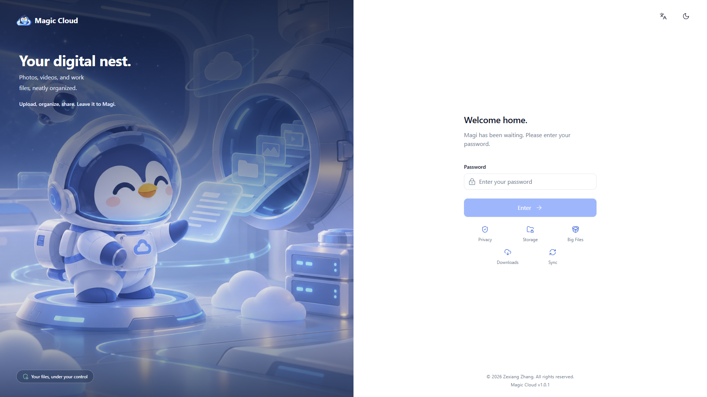
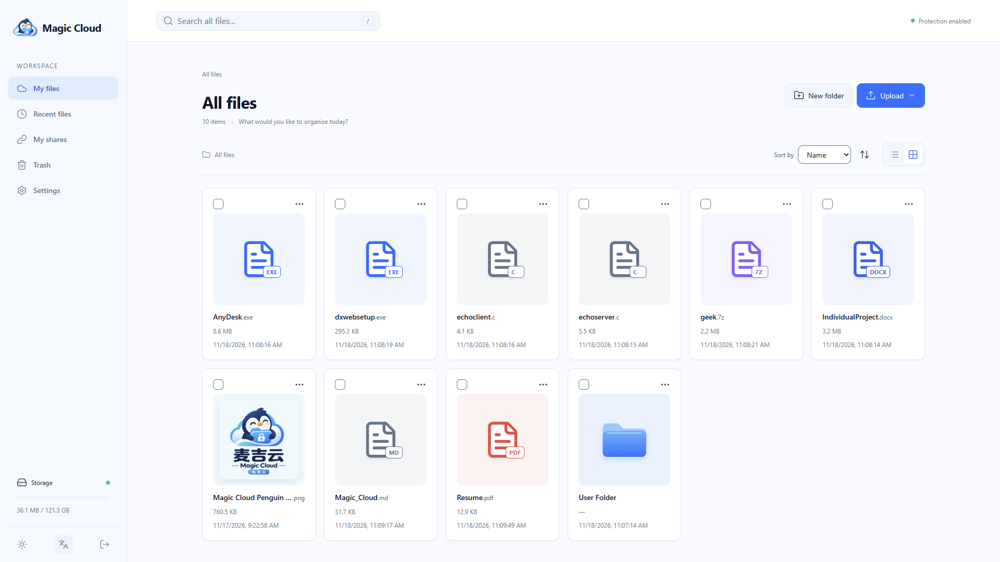
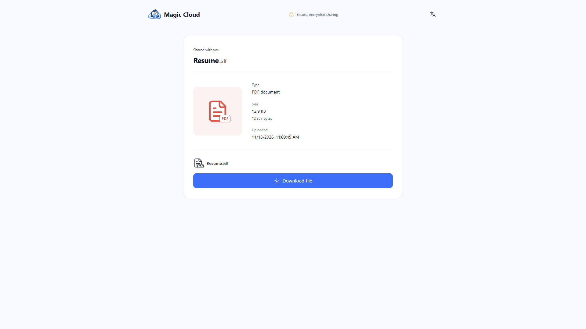

<div align="center">
  
  <h1>Magic Cloud · 麦吉云</h1>
  <p>Lightweight, self-hosted private storage · v1.0.1</p>
  <p><strong>English</strong> · <a href="README.zh-CN.md">简体中文</a></p>
</div>

Keep your files on your own Linux computer, server, or Raspberry Pi. Manage them in a browser on your LAN, with optional remote access through Cloudflare Tunnel.

## Features

- Folders, filename search, recent files, grid/list views, and bulk move/trash.
- Uploads up to 10 GB per file, 16 MiB chunks, pause/resume, and folder uploads. After a refresh, reselect the original file within 24 hours to resume.
- Image, audio, text/code previews and static video covers. Other formats can be downloaded.
- Download-only share links with expiry and revocation; 30-day trash.
- SQLite backups, Chinese/English, and light/dark themes.

## Screenshots

### Sign in



### File management



### File sharing



## Requirements

- Linux AMD64 or ARM64, kernel 5.6+ with `openat2`. Raspberry Pi 4/5 requires a **64-bit OS**. See [validation results](docs/validation.md) for tested architectures and limits.
- [Docker Engine](https://docs.docker.com/engine/install/) and the [Compose plugin](https://docs.docker.com/compose/install/linux/). For Raspberry Pi OS 64-bit, use Docker's [Debian instructions](https://docs.docker.com/engine/install/debian/).
- A dedicated writable directory on persistent storage. An internal disk is enough; external SSDs, HDDs and USB flash drives are optional.
- Git, Bash, OpenSSL, Python 3 and util-linux for the host setup scripts. Rust and Node.js run inside build containers.

On Debian/Ubuntu/Raspberry Pi OS, install host helpers with `sudo apt install git openssl python3 util-linux`. Confirm `docker version` and `docker compose version` work before continuing. The following Docker commands assume your account can access Docker; otherwise use `sudo docker`.

## Quick deployment

```bash
git clone --branch dev https://github.com/626-Legendary/magic-cloud.git
cd magic-cloud
cp .env.example .env
chmod 600 .env
openssl rand -hex 32
```

Edit `.env`: set your login `APP_PASSWORD` (at least 12 bytes), a separate random `SESSION_SECRET` (at least 32 characters), and the settings below. Run the random generator separately for each credential. Use plain unquoted values; hexadecimal values avoid Compose interpolation issues.

For a server at `192.168.0.101` using its internal disk:

```dotenv
STORAGE_MODE=local
STORAGE_MOUNT=/srv/magic-cloud
LAN_BIND_ADDRESS=192.168.0.101
LAN_ORIGIN=http://192.168.0.101:5080
APP_ORIGIN=
CLOUDFLARE_TUNNEL_TOKEN=
```

Replace the IP with your server's actual LAN IP. Create and explicitly initialize the dedicated directory:

```bash
sudo deploy/scripts/storage.sh mount
sudo deploy/scripts/storage.sh init --initialize-empty
```

Copy the printed `STORAGE_ID` into `.env`, then start:

```bash
sudo deploy/scripts/storage.sh check
docker compose config --quiet
docker compose up -d --build
docker compose ps
```

Open **http://192.168.0.101:5080** and sign in with `APP_PASSWORD`. There is no separate account setup. The default `.env.example` binds to loopback; set both LAN variables for access from another device.

## Storage directories

**Local directory:** use `STORAGE_MODE=local` and an absolute `STORAGE_MOUNT`, such as `/srv/magic-cloud`. No UUID or dedicated mount point is required. Use a persistent Linux filesystem with file locking, fsync and atomic renames; ext4 is the verified setup.

**External/dedicated disk:** use `lsblk -f` to identify an existing ext4 filesystem, then configure:

```dotenv
STORAGE_MODE=external
STORAGE_MOUNT=/mnt/magic-cloud
STORAGE_UUID=your-ext4-filesystem-uuid
```

Run the same `mount`, explicit `init`, and `check` commands above. For existing Magic Cloud storage, keep its original `STORAGE_ID` and **skip initialization**. No script formats disks or imports files copied outside the app.

Compose bind-mounts `STORAGE_MOUNT` at `/data`, with automatic host directory creation disabled. Files are stored in `files/`; SQLite, uploads, trash and backups in `.magic-cloud/`. Initialization assigns these directories to `APP_UID:APP_GID` (default `10001:10001`); don't use `chmod 777`.

After the image has been built, install recovery and boot setup:

```bash
sudo python3 deploy/scripts/install-storage.py
```

In external mode this verifies the existing disk, fixes its mount at `/mnt/magic-cloud`, backs up and updates `/etc/fstab`, updates `.env`, and enables the systemd recovery timer. In local mode it keeps the configured directory and installs the timer without editing fstab. Both modes recreate the app container. Desktop login is unnecessary. Re-run the installer if the project directory moves.

External mode checks UUID, ext4, writability and storage ID. Missing/wrong storage stops service; it never initializes a replacement database in the empty mount directory. Reconnection triggers verification and container recreation. Local mode checks directory identity and the same storage marker/layout, without USB requirements. See [operations and recovery](docs/operations.md).

## Environment variables

See [.env.example](.env.example) for all values.

| Variable | Meaning |
| --- | --- |
| `APP_PASSWORD`, `SESSION_SECRET` | Login password and independent session/encryption secret |
| `STORAGE_MODE` | `local` or `external`; omitted values retain the older external mode |
| `STORAGE_MOUNT`, `STORAGE_ID` | Absolute data directory and initialized identity |
| `STORAGE_UUID` | Filesystem UUID, required only in external mode |
| `APP_UID`, `APP_GID` | Container user and initialized directory owner; default `10001` |
| `PORT` | Host and container port; default `5080` |
| `LAN_BIND_ADDRESS`, `LAN_ORIGIN` | Bind IP and exact trusted HTTP origin, including port |
| `APP_ORIGIN` | Optional exact public HTTPS origin, without trailing slash |
| `APP_VERSION` | Build-time UI version, `1.0.1`; rebuild after changing |
| `BACKUP_INTERVAL_SECONDS`, `BACKUP_KEEP` | Default `86400` seconds and `7` database snapshots |
| `SAFETY_MARGIN_BYTES`, `SAFETY_MARGIN_PERCENT` | Reserved space: the larger of 2 GiB or 5% by default |

Configure at least one access origin. Trusted LAN HTTP uses a separate session from public HTTPS.

## Start, stop and inspect

```bash
docker compose up -d                    # Background startup
docker compose ps
docker compose logs -f --tail=100 magic-cloud
docker compose restart magic-cloud    # Restart with current configuration
```

To keep the recovery timer from restarting a deliberately stopped app:

```bash
sudo systemctl stop magic-cloud-storage.timer  # If installed
docker compose stop magic-cloud
# To resume:
docker compose up -d
sudo systemctl start magic-cloud-storage.timer
```

`docker compose down` removes containers/network, keeping bind-mounted data. After editing `.env`, use `docker compose up -d --force-recreate magic-cloud`; `restart` does not apply new variables.

## Cloudflare Tunnel remote access (optional)

Set `APP_ORIGIN=https://cloud.example.com` and `CLOUDFLARE_TUNNEL_TOKEN` to the **full connector token**, not the tunnel UUID. In Cloudflare, route the hostname to **`http://magic-cloud:5080`** (adjust if `PORT` differs).

```bash
docker compose --profile tunnel up -d --build
```

The default startup runs the app without a tunnel or token. If you previously used the tunnel, explicitly enable its `tunnel` profile when recreating it. LAN and public access can coexist. A LAN share is reachable only from that LAN. Proxy request limits and account rules still apply to large transfers.

## Update and maintain

Back up first, keep the same data directory/ID and secrets, then:

```bash
sudo systemctl stop magic-cloud-storage.timer  # If installed
git pull --ff-only origin dev
# Set APP_VERSION=1.0.1 in .env for this upgrade.
docker compose up -d --build --no-deps magic-cloud
docker compose ps
docker compose logs --tail=100 magic-cloud
sudo systemctl start magic-cloud-storage.timer  # If installed
```

If a Pi runs out of memory while building, use `docker compose build --build-arg CARGO_BUILD_JOBS=1 magic-cloud`, then `docker compose up -d`. Changing passwords invalidates old sessions; changing `SESSION_SECRET` also affects copying existing encrypted share links.

## Backups

Create/download a consistent SQLite snapshot in **Settings → Backups**. Automatic snapshots do **not** include user files. Keep `.env`/`SESSION_SECRET` and files separately protected.

For a complete offline backup, stop the timer (if installed) and app, then copy the entire data layout. Example for local storage:

```bash
sudo systemctl stop magic-cloud-storage.timer  # If installed
docker compose stop magic-cloud
sudo install -d -m 700 /var/backups/magic-cloud
sudo tar -C /srv/magic-cloud -czf /var/backups/magic-cloud/storage.tar.gz files .magic-cloud
sudo cp .env /var/backups/magic-cloud/env
docker compose up -d
sudo systemctl start magic-cloud-storage.timer  # If installed
```

Use `/mnt/magic-cloud` instead of `/srv/magic-cloud` for external storage. Copy the backup to another device; a backup on the same disk does not protect against disk failure. Follow [manual restoration](docs/operations.md) before restoring SQLite; never mix a snapshot with unrelated WAL/SHM or files.

## FAQ

- **Restart loop / `storage_io_error`:** inspect logs, `lsblk -f`, `findmnt -T <data-directory>` and `sudo deploy/scripts/storage.sh check`. Verify mount, marker and UID/GID. Don't initialize existing data again.
- **Cannot open port 5080:** default binding is `127.0.0.1`. Set both LAN variables to the server IP/origin, check the firewall, and recreate the container.
- **Disk missing at boot:** Docker restart policies do not mount host disks. Install the storage recovery task; external storage also needs its fstab entry.
- **No thumbnail/preview:** unsupported or damaged media falls back to its icon/download. Video is a static cover, not in-browser playback; public shares never preview file contents.

## Technology and development

Vue 3, TypeScript, Vite, Rust/Axum, SQLite and FFmpeg. Run `./deploy/scripts/check.sh` for containerized checks. See [architecture](docs/architecture.md), [API](docs/api.md), [security](docs/security.md), [UI](docs/ui-design.md), and [validation](docs/validation.md). Browser tests require disposable storage.
