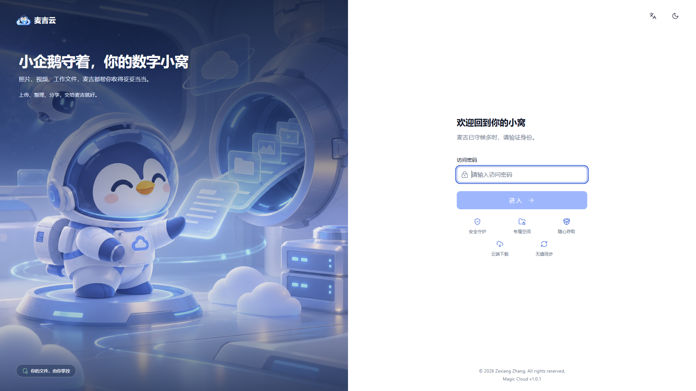
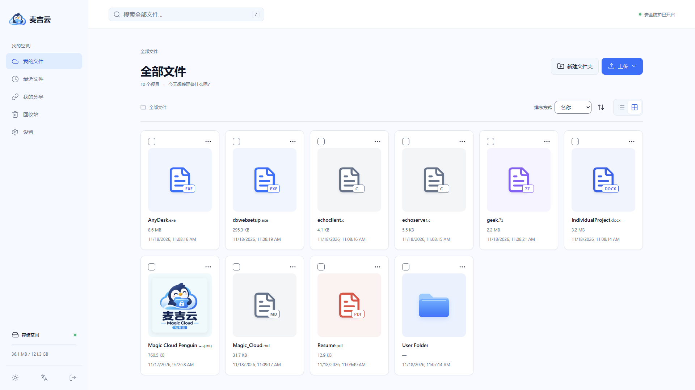
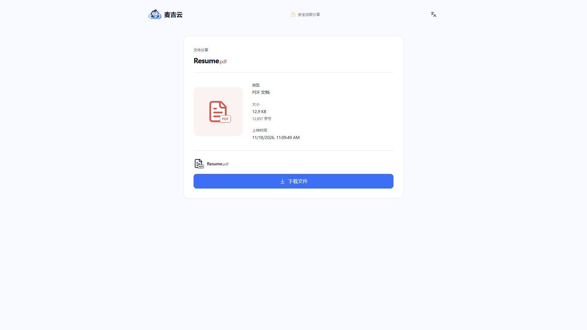

<div align="center">
  
  <h1>Magic Cloud · 麦吉云</h1>
  <p>轻量、自托管的私人云存储 · v1.0.1</p>
  <p><a href="README.md">English</a> · <strong>简体中文</strong></p>
</div>

通过 Docker，将 Linux 电脑、服务器或树莓派上的磁盘目录变成私人网盘。支持局域网访问，也可选用 Cloudflare Tunnel 远程访问。

## 主要功能

- 文件夹、全盘文件名搜索、最近文件、网格/列表、批量移动与回收站。
- 单文件最高 10 GB、16 MiB 分片、暂停/恢复、文件夹上传；刷新后 24 小时内重选原文件恢复任务。
- 图片、音频、文本/代码预览和静态视频封面，其他格式可下载。
- 可设有效期、可撤销的只读下载分享，30 天回收站。
- SQLite 定时备份、中英文和明暗主题。

## 界面预览

### 登录页面



### 文件管理



### 文件分享



## 系统要求

- Linux AMD64 或 ARM64，内核 5.6+，支持 `openat2`。树莓派 4/5 需安装 **64 位系统**；实际架构验证范围见[验证记录](docs/validation.md)。
- [Docker Engine](https://docs.docker.com/engine/install/) 与 [Compose 插件](https://docs.docker.com/compose/install/linux/)。Raspberry Pi OS 64-bit 按 Docker 的 [Debian 指南](https://docs.docker.com/engine/install/debian/)安装。
- 一个专用、可读写的持久化数据目录；内部磁盘即可，也可用外置 SSD、HDD 或 U 盘。
- 宿主机需 Git、Bash、OpenSSL、Python 3、util-linux。Rust 和 Node.js 只在构建容器内运行。

Debian/Ubuntu/树莓派可执行 `sudo apt install git openssl python3 util-linux` 安装辅助工具。开始前确认 `docker version` 和 `docker compose version` 正常。下方假设当前账号可访问 Docker，否则将 `docker` 替换为 `sudo docker`。

## 快速部署

```bash
git clone --branch dev https://github.com/626-Legendary/magic-cloud.git
cd magic-cloud
cp .env.example .env
chmod 600 .env
openssl rand -hex 32
```

编辑 `.env`：设置登录密码 `APP_PASSWORD`（至少 12 字节）和独立随机密钥 `SESSION_SECRET`（至少 32 字符）。分别生成独立随机值，使用不带引号的普通配置；十六进制值可避免 Compose 插值问题。

以服务器 IP `192.168.0.101`、内部磁盘目录为例：

```dotenv
STORAGE_MODE=local
STORAGE_MOUNT=/srv/magic-cloud
LAN_BIND_ADDRESS=192.168.0.101
LAN_ORIGIN=http://192.168.0.101:5080
APP_ORIGIN=
CLOUDFLARE_TUNNEL_TOKEN=
```

替换为你的实际 IP，然后创建目录并显式初始化：

```bash
sudo deploy/scripts/storage.sh mount
sudo deploy/scripts/storage.sh init --initialize-empty
```

将输出的 `STORAGE_ID` 写入 `.env`，启动服务：

```bash
sudo deploy/scripts/storage.sh check
docker compose config --quiet
docker compose up -d --build
docker compose ps
```

打开 **http://192.168.0.101:5080**，使用 `APP_PASSWORD` 登录，无需额外注册。示例配置默认仅绑定 `127.0.0.1`；其他设备访问需要同时设置两个 LAN 变量。

## 存储目录配置

**方式 A：外置或专用磁盘。** 用 `lsblk -f` 查找已经存在的 ext4 文件系统：

```dotenv
STORAGE_MODE=external
STORAGE_MOUNT=/mnt/magic-cloud
STORAGE_UUID=实际的ext4文件系统UUID
```

再执行上面的 `mount`、显式 `init` 和 `check`。已有麦吉云存储保留原 `STORAGE_ID`，**跳过初始化**；脚本不格式化、不自动导入外部拷入的文件。

**方式 B：本地目录。** 使用 `STORAGE_MODE=local` 和绝对路径，例如 `/srv/magic-cloud`。不要求专用挂载点或 UUID。应使用支持文件锁、fsync 和原子重命名的持久化 Linux 文件系统；本次验证使用 ext4。

Compose 将 `STORAGE_MOUNT` 绑定到容器 `/data`，禁止自动创建宿主机目录。原始文件位于 `files/`，数据库、临时上传、回收站和备份位于 `.magic-cloud/`。初始化设置专用目录所有者为 `APP_UID:APP_GID`，默认 `10001:10001`；无需 `chmod 777`。

镜像构建完成后，安装开机恢复：

```bash
sudo python3 deploy/scripts/install-storage.py
```

外置模式会校验现有数据盘，固定挂载到 `/mnt/magic-cloud`，备份并更新 `/etc/fstab`、更新 `.env`，安装 systemd 恢复任务。本地模式保留原目录，只安装恢复任务、不改 fstab。两种模式均会重建应用容器。重启无需登录桌面；移动项目目录后需要重新执行安装。

外置模式校验 UUID、ext4、可写状态和存储 ID；掉盘或错盘时停止服务，不在空挂载目录创建新库。正确磁盘恢复后校验并重建容器。本地模式校验目录身份、存储标记和布局，不依赖 USB 设备。详见[运维与恢复](docs/operations.md)。

## 环境变量

完整示例见 [.env.example](.env.example)。

| 变量 | 用途 |
| --- | --- |
| `APP_PASSWORD`、`SESSION_SECRET` | 登录密码及独立会话/分享加密密钥 |
| `STORAGE_MODE` | `local` 或 `external`；旧配置未填写时保留外置模式 |
| `STORAGE_MOUNT`、`STORAGE_ID` | 数据目录绝对路径和初始化生成的身份标记 |
| `STORAGE_UUID` | 仅外置模式需要的文件系统 UUID |
| `APP_UID`、`APP_GID` | 容器用户及专用目录所有者，默认均为 `10001` |
| `PORT` | 宿主机和容器端口，默认 `5080` |
| `LAN_BIND_ADDRESS`、`LAN_ORIGIN` | 绑定 IP 和完整可信 HTTP Origin，包含端口 |
| `APP_ORIGIN` | 可选公网 HTTPS Origin，不带末尾 `/` |
| `APP_VERSION` | 前端构建版本 `1.0.1`，修改后需重新构建 |
| `BACKUP_INTERVAL_SECONDS`、`BACKUP_KEEP` | 默认每 `86400` 秒备份数据库，保留 `7` 份 |
| `SAFETY_MARGIN_BYTES`、`SAFETY_MARGIN_PERCENT` | 默认预留 2 GiB 与磁盘 5% 中较大的值 |

至少配置一个访问 Origin。局域网 HTTP 仅用于可信网络，与公网 HTTPS 分别登录。

## 启动与访问

```bash
docker compose up -d                 # 后台启动
docker compose ps
docker compose logs -f --tail=100 magic-cloud
docker compose restart magic-cloud  # 以当前配置重启
```

主动停机时，先停止恢复任务，避免它再次启动应用：

```bash
sudo systemctl stop magic-cloud-storage.timer  # 已安装时执行
docker compose stop magic-cloud
# 恢复服务：
docker compose up -d
sudo systemctl start magic-cloud-storage.timer
```

`docker compose down` 删除容器和项目网络，保留绑定目录内的数据。修改 `.env` 后执行 `docker compose up -d --force-recreate magic-cloud`；单纯 `restart` 不应用新的环境变量。

## Cloudflare Tunnel 远程访问（可选）

设置 `APP_ORIGIN=https://cloud.example.com` 和 `CLOUDFLARE_TUNNEL_TOKEN`。Token 必须是完整连接器令牌，不能填写 Tunnel UUID。在 Cloudflare 将域名指向 **`http://magic-cloud:5080`**；修改 `PORT` 时同步修改该地址。

```bash
docker compose --profile tunnel up -d --build
```

默认启动无需域名或 Token。旧部署重建隧道时也需显式启用 `tunnel` profile。公网与 LAN 可同时使用；从 LAN 创建的分享地址只有能访问该 LAN 的接收者可用。大文件传输仍受代理请求限制及账户规则影响。

## 更新与维护

先备份，保留原数据目录、存储 ID 和密钥，再执行：

```bash
sudo systemctl stop magic-cloud-storage.timer  # 已安装时执行
git pull --ff-only origin dev
# 本次升级将 .env 的 APP_VERSION 改为 1.0.1。
docker compose up -d --build --no-deps magic-cloud
docker compose ps
docker compose logs --tail=100 magic-cloud
sudo systemctl start magic-cloud-storage.timer  # 已安装时执行
```

树莓派构建内存不足时使用 `docker compose build --build-arg CARGO_BUILD_JOBS=1 magic-cloud`，然后 `docker compose up -d`。更换密码使旧会话失效；更换 `SESSION_SECRET` 还会影响复制已有的加密分享链接。

## 数据备份

可在“设置 → 数据库备份”创建和下载一致性快照。自动数据库备份**不包含原始文件**，还需保管 `.env`、`SESSION_SECRET` 及文件副本。

完整离线备份应先停恢复任务和应用，以本地目录为例：

```bash
sudo systemctl stop magic-cloud-storage.timer  # 已安装时执行
docker compose stop magic-cloud
sudo install -d -m 700 /var/backups/magic-cloud
sudo tar -C /srv/magic-cloud -czf /var/backups/magic-cloud/storage.tar.gz files .magic-cloud
sudo cp .env /var/backups/magic-cloud/env
docker compose up -d
sudo systemctl start magic-cloud-storage.timer  # 已安装时执行
```

外置模式将 `/srv/magic-cloud` 替换为 `/mnt/magic-cloud`。随后把备份复制到另一台设备；同盘备份无法防止整盘损坏。恢复前阅读[人工恢复步骤](docs/operations.md)，不要混用快照、其他状态的 WAL/SHM 和原文件。

## 常见问题

- **一直重启 / `storage_io_error`：** 查看日志、`lsblk -f`、`findmnt -T <数据目录>`，执行 `sudo deploy/scripts/storage.sh check`，检查挂载、身份标记和 UID/GID。不要重新初始化已有数据。
- **其他设备无法打开 5080：** 默认只绑定回环地址；设置两个 LAN 变量、检查防火墙并重建容器。
- **开机磁盘没挂载：** Docker 自动重启不负责宿主机磁盘挂载；安装恢复任务，外置模式同时配置 fstab。
- **没有封面或预览：** 不支持或损坏的文件降级为图标和下载。视频只显示静态封面；公开分享不预览文件内容。

## 技术栈与开发

Vue 3、TypeScript、Vite、Rust/Axum、SQLite、FFmpeg。执行 `./deploy/scripts/check.sh` 完成容器化检查。其他文档：[架构](docs/architecture.md)、[API](docs/api.md)、[安全](docs/security.md)、[UI](docs/ui-design.md)、[验证指南](docs/validation.md)。浏览器回归仅使用可丢弃数据。
